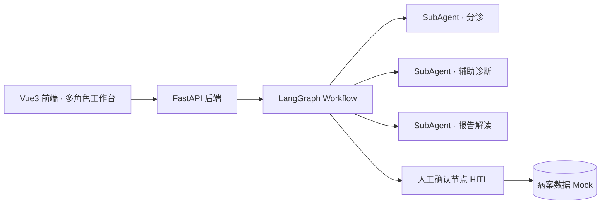

# MedFlow-Agent · 医院多角色诊疗协作 Agent

基于 **LangGraph Workflow** 的医院多角色诊疗协作 Agent 系统：主治医生、检验技师、影像技师、MDT 专家、护士等多角色在各自隔离的工作台中协同完成诊疗流程，AI 生成建议、医生确认执行（HITL 人机协同范式）。

## 核心设计

### 多角色工作台（权限与视图隔离）

| 角色 | 工作台 | 能力边界 |
|---|---|---|
| 系统管理员 | 后台管理 | 用户与数据管理 |
| 主治医生 | 全权工作台 | 发起诊疗、确认 AI 建议 |
| 检验/影像技师 | 科室工作台 | 科室任务处理 |
| MDT 专家 | 会诊视图 | 跨科室评论协作 |
| 护士 / 只读医生 | 分诊只读 / 全病案只读 | 最小权限视图 |

### Agent 架构



- **Workflow 编排**：诊疗流程状态机驱动，节点可插拔 SubAgent
- **HITL 范式**：AI 建议 → 医生确认 → 落病案，兼顾效率与医疗安全
- **角色权限隔离**：按角色路由工作台与数据视图（RBAC）

## 技术栈

`Python` `FastAPI` `LangGraph` `Vue3` `Pinia` `Vite`

## 运行

```bash
# 后端
cd backend && uvicorn main:app --port 8002
# 前端
cd frontend && npm run dev
```

演示账号：`attending / 123456`（主治医生）· `mdtexpert / 123456`（MDT 专家）
数据均为内存 Mock，不连接真实 HIS。

## 设计方法论

本项目由 AX（AI 体验设计）主导：体验目标 → 可评测指标 → 交互范式（HITL）→ 前端实现，设计资产与评测标准前置为开发契约。
