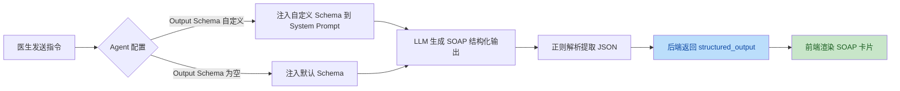

# 医院诊疗 Agent 工作台 Demo

> 垂直医疗 B 端 Agent 工作台：**LangGraph Workflow 骨架 + 可插拔 SubAgent 节点（方案A：同一节点内 if 开关分支）**。
> 区分确定性规则 Workflow（权限 / 审批 / MDT / 任务流转 / 审计 / 版本）与认知型 SubAgent（病历草稿 / 检验汇总）；强制 HITL 卡点，AI 输出独立隔离，绝不自动写入正式病历。

本 Demo 全 Mock，不对接真实 HIS / LIS / PACS / DICOM / 院内 IM，仅演示**业务编排、权限视图、MDT 协作、版本归档、Agent 开关逻辑**。

---

## 一、业务背景

医院诊疗场景长期存在三个痛点：

1. **多角色协作链路长**：主治医生、MDT 会诊专家、护士、历史接诊医生在同一患者上频繁切换，权限边界模糊、留痕不完整。
2. **AI 生成内容不敢直接落病历**：病历是医疗责任凭证，AI 草稿若自动写入正式病历将带来合规与医疗安全风险，必须人工终审。
3. **认知型 AI 与规则流程耦合混乱**：把 LLM 调用塞进业务流程里，一旦模型不可用或被关停，整条流程就崩。

本 Demo 用 **LangGraph Workflow 管规则、SubAgent 管认知、二者解耦 + HITL 终审** 的架构，演示一套可解释、可关停、可审计的诊疗工作台。

---

## 二、用户分层

| 用户层 | 角色 | 核心诉求 | Demo 对应 |
| --- | --- | --- | --- |
| 患者 | 就诊者 | 得到及时、准确、可追溯的诊疗 | 演示数据中的患者（张伟 / 李娜） |
| 护士 | 分诊执行层 | 快速看到排队、检查任务状态，不卷入病历 | 护士视图：仅基础信息 + 检查任务只读 |
| 主治医生 | 诊疗决策层 | 高效完成病历、方案、开单、MDT 协作与终审 | 主治工作台：全权操作 + HITL 终审 |
| MDT 会诊专家 | 协作专家层 | 专注给出会诊意见，不被编辑/开单等噪音干扰 | MDT 专家视图：仅评论输入 + 只读病历 |
| 历史参与医生 | 旧接诊/回溯 | 查阅历史病程与讨论，不新增改动 | 只读视图：全病案只读，评论框隐藏 |
| 医院运营 | 管理层 | 可审计、可关停 AI、合规留痕 | SubAgent 配置页 + 审计日志 |

---

## 三、产品目标

- 把 **确定性规则**（权限校验、MDT 临时授权、任务状态流转、版本归档、审计落盘）与 **认知型 AI**（病历草稿、检验汇总）拆开：规则节点不调用 LLM，AI 可被一键关停而不影响流程主干。
- 用 **同一套 LangGraph**（方案A：节点内 `if enable_subagent` 分支）实现「开 AI / 关 AI」两条路径，收敛到同一 HITL 终审卡点，避免维护两套 Graph。
- AI 草稿与专家意见**独立隔离**，只有主治人工确认后才可手动采纳到正式病历，确保医疗责任清晰。

---

## 四、商业价值

- **合规与医疗安全**：AI 输出不自动落库 + 全量审计留痕 + 版本只增不改，满足病历合规追溯要求。
- **可解释、可关停**：SubAgent 是可插拔插件，医院可按科室 / 场景随时关闭 AI，回归纯人工流程，降低引入风险。
- **协作效率**：MDT 临时授权 + 时效控制 + 采纳留痕，减少会诊协作摩擦与责任扯皮。
- **落地成本低**：规则主干稳定，AI 部分可渐进替换真实 LLM，无需推翻整体架构。

---

## 五、商业模式（Demo 设想）

| 模式 | 说明 |
| --- | --- |
| 私有化部署 | 按医院 / 科院订阅，含工作台 + SubAgent 配置后台，部署在医院内网 |
| SubAgent 插件市场 | 病历草稿、检验汇总、影像辅助等认知型 SubAgent 按插件计费，规则 Workflow 平台底座免费 |
| 审计与合规增值 | 长期版本归档、采纳留痕、操作审计作为合规模块按年付费 |
| 实施服务 | 角色权限矩阵、MDT 流程定制按项目交付 |

---

## 六、LangGraph 架构说明

### 6.1 全局 State（TypedDict）

`backend/app/graph/state.py` 中的 `PatientState` 是贯穿整个 Workflow 的全局状态：

```
PatientState {
  patient_id, patient_name, attending_doctor_ids      # 患者与数据范围
  mdt_invitations[]                                   # MDT 临时授权白名单（带时效）
  emr_main                                            # 正式主病历（HITL 锁定）
  treatment_versions[]                                # 诊疗方案版本（倒序，只增不改）
  ai_draft                                            # AI 草稿（隔离区，不进 emr_main）
  mdt_comments[]                                      # MDT 意见（冻结留痕 + 采纳标记）
  check_tasks[]                                       # 检查任务（ordered→pending→done）
  enable_emr_subagent, enable_lab_subagent            # SubAgent 开关
  audit_log[], notify_queue[]                         # 审计日志 / Mock 站内通知
  status, hitl_pending                                # 流转状态 / HITL 卡点
}
```

### 6.2 七个节点

| # | 节点 | 类型 | 职责 |
| --- | --- | --- | --- |
| 1 | `node_admission_guard` | 纯 Workflow | 准入 & 权限校验（患者状态准入，细粒度 RBAC 在 API 层） |
| 2 | `node_admit_emr` | **同节点 if 分支** | `enable_emr_subagent` 开启→调用病历 SubAgent 生成草稿；关闭→跳过 AI；两条分支收敛至 HITL |
| 3 | `node_open_check_task` | 纯 Workflow | 开立检查任务，Mock 状态流转 + 完成回填 |
| 4 | `node_mdt_invite` | 子 Workflow | MDT 邀请：临时授权 + 时效控制 + 白名单写入 |
| 5 | `node_new_treatment` | 纯 Workflow | 新建诊疗方案版本（version_no +1，不覆盖旧版） |
| 6 | `node_adopt_mdt_comment` | 纯 Workflow | 采纳 MDT 意见：写入标记 + 推送通知（独立留痕） |
| 7 | `node_archive_audit` | 纯 Workflow | 归档 & 审计落盘 |

### 6.3 Workflow 编排

- **主接诊流程图** `admission_graph`：`START → 准入校验 → 接诊(节点内 if 分支) → HITL 卡点`
- **MDT 邀请子图** `mdt_invite_graph`：`START → MDT 邀请 → END`
- 其余节点为纯函数节点，由 FastAPI 路由按需调用，**复用同一份 `nodes.py`**，逻辑单点维护。

### 6.4 Workflow + SubAgent 解耦思路（方案A）

```
            ┌── enable_emr_subagent=True  → 调用 SubAgent 生成 ai_draft（隔离区）
接诊节点 ──┤
            └── enable_emr_subagent=False → 跳过 AI，走人工编辑
                         │
                         ▼
                  同一 HITL 终审卡点（主治人工确认）
                         │
                         ▼
            采纳到正式病历（仅人工触发，不自动写入）
```

- **不维护两套 Graph**：开关只决定节点内是否调用 SubAgent，图结构不变。
- **AI 输出物理隔离**：`ai_draft` 与 `emr_main` 是 State 中两个独立字段，SubAgent 只写 `ai_draft`。
- **HITL 强制卡点**：`hitl_pending=True` 后图暂停，必须主治人工定稿锁定才落库。

---

## 六之二、医疗轻量 OAG 底座（TBox + ABox 本体语义规范）

> 全平台所有 Agent 的唯一可信数据底座，**不引入重型 OWL 推理机**，以代码层实现公理校验。
> 代码位置：`backend/app/graph/ontology.py`（TBox 类定义+公理校验）、`backend/app/graph/abox.py`（内存对象图）、`backend/app/graph/temporal_query.py`（时态图查询）。

### 6.2.1 TBox 固定实体类定义（Schema 层）

| 类 | 命名空间 | 核心属性 | 说明 |
| --- | --- | --- | --- |
| `Patient` | `Person` | patient_id, patient_name, gender, age | 患者，与 `Doctor` 业务身份互斥 |
| `Doctor` | `Person` | doctor_id, doctor_name, title | 医生，可多条 `work_in` 关系（含时效性） |
| `Nurse` | `Person` | nurse_id, nurse_name | 护士 |
| `Department` | `Space` | dept_id, dept_name, category | 科室 |
| `Room` | `Space` | room_id, room_name, building, floor | 房间/诊室 |
| `VisitRecord` | `MedicalFlow` | visit_id, patient_id, start_time, end_time, status | 就诊记录（核心时态锚点） |
| `ExamReport` | `MedicalFlow` | report_id, patient_id, visit_id, report_type, content | 检验/影像报告 |
| `ExamItem` | `MedicalFlow` | item_code, item_name, category, spec | 检验/检查项目字典 |
| `OrderRecord` | `MedicalFlow` | order_id, patient_id, visit_id, order_type | 医嘱/开立记录 |

### 6.2.2 TBox 固定关系定义（对象关系，强业务语义）

| 关系 | 源类 → 目标类 | 业务语义 | 时态属性 |
| --- | --- | --- | --- |
| `work_in` | `Doctor` → `Department` | 医生任职科室 | valid_time: [start, end]，每日排班动态生效 |
| `locate_in` | `Department` → `Room` | 科室对应诊室 | valid_time: 长期有效 |
| `has_visit` | `Patient` → `VisitRecord` | 患者拥有就诊记录 | valid_time: 就诊时段 |
| `generate` | `VisitRecord` → `ExamReport` | 就诊产生报告 | valid_time: 报告生成时间 |
| `belong_to` | `ExamReport` → `Patient` | 报告唯一归属患者 | valid_time: 长期有效 |
| `execute_in` | `VisitRecord` → `Room` | 就诊发生诊室 | valid_time: 就诊时段 |
| `order_item` | `OrderRecord` → `ExamItem` | 医嘱开立项目 | valid_time: 开立时间 |

### 6.2.3 TBox 核心公理（代码层强制校验）

| 公理 | 约束 | 代码实现 |
| --- | --- | --- |
| **唯一归属公理** | 一份 `ExamReport` 恰好 1 个 `Patient` | `validate_belong_to_uniqueness()` — 创建报告时强制校验 |
| **身份互斥公理** | `Doctor` 与 `Patient` 业务身份完全互斥 | `validate_identity_mutex()` — 注册时校验，同一 user_id 不可同时为医生和患者 |
| **时态核心公理** | 所有关系带 `valid_time: [start, end]` | 边创建时强制写入，查询时必须传时间窗口 |
| **基数约束** | 一条 `VisitRecord` 仅归属一个 `Patient` | `validate_visit_cardinality()` — 创建就诊记录时校验 |
| **上下文隔离公理** | 默认查询仅返回「本次就诊」数据 | `temporal_query.py` 所有函数强制 `time_window` 参数，不传则默认本次就诊 |

### 6.2.4 ABox 内存对象图结构

```
OGraph (内存单例)
├── nodes: Dict[node_id, {type, data, create_time, valid_time}]
│   ├── type: Patient/Doctor/Nurse/Department/Room/VisitRecord/ExamReport/ExamItem/OrderRecord
│   └── data: 对应实体的完整属性字典
├── edges: List[{source_id, target_id, rel_type, valid_time, create_time, permission_tag, trace_id}]
│   ├── rel_type: work_in / locate_in / has_visit / generate / belong_to / execute_in / order_item
│   └── valid_time: [start_iso, end_iso]  # None 表示长期有效
└── meta: {version, last_sync, axiom_checks_enabled}
```

### 6.2.5 三类时态图查询（上层 Agent 直接调用）

| 查询函数 | 输入 | 输出 | 核心用途 |
| --- | --- | --- | --- |
| `patient_full_chain(patient_id, time_window)` | 患者ID + 时间窗口 | 就诊记录+全部报告+医生+房间+时段 | MDT 会诊资料自动聚合 |
| `visit_context_isolation(visit_id)` | 就诊ID | 隔离的本次就诊全链路数据（不含历史） | 防止信息混杂，默认隔离 |
| `doctor_on_duty(doctor_id, date)` | 医生ID + 日期 | 当日接诊患者+诊室+病例资料 | 下班复盘、MDT 讨论 |

### 6.2.6 工程落地规则

- **不引入 Neo4j**：优先「内存模拟对象图 + 结构化 Schema 校验」，可无缝对接后续图库
- **公理代码校验**：所有 TBox 公理通过 `ontology.py` 校验函数实现，不依赖 OWL 推理机
- **时态熔断**：默认所有查询带 `time_window`，不传则默认只返回本次就诊数据
- **权限标签**：每条边携带 `permission_tag`，适配医疗合规审计
- **溯源 ID**：每条边携带 `trace_id`，打通 LangGraph TraceId

### 6.2.7 三端统一数据同源规则

| 端 | 读取层 | 写入层 | 权限控制 |
| --- | --- | --- | --- |
| 患者端 H5 | OGraph + 只读视图隔离 | 仅 AI 导诊会话写入 | role=patient，隔离 ai_draft/mdt_comments |
| 医生 PC 工作台 | OGraph + 全链路视图 | 病历/方案/检查/MDT | role=attending/mdt_expert/nurse/readonly |
| 后台管理 | OGraph + 审计视图 | 主数据/RAG/Agent配置 | role=admin，require_admin 依赖保护 |

### 6.2.8 严格禁止清单

- ❌ 不搭建疾病/症状/药理医学知识图谱（二期再做）
- ❌ 不引入 OWL DL 推理、复杂描述逻辑推理
- ❌ Agent 不自主生成诊疗方案、诊断结论
- ❌ 不做无时间隔离的全量数据遍历（默认时间窗口熔断）

---

## 七、权限与视图规则

- **动作权限**（能不能编辑 / 采纳 / 开单）与 **病例数据范围**（能看哪些患者）解耦，后端强制二次鉴权，前端仅做视图显隐。
- 资源级动作权限由 `require_action(action)` 依赖在后端强制（如护士直接请求 `GET /mdt/comments` 返回 403）。
- 护士 `GET /patients/{id}` 返回脱敏 State（仅基础信息 + 检查任务），不返回 emr / mdt / 历史 / audit。

| 角色 | 编辑/定稿/AI/开单/邀请/采纳 | 提交评论 | 查看历史 | 查看 MDT | 查看检查 |
| --- | --- | --- | --- | --- | --- |
| 主治医生 | ✅ | ❌ | ✅ | ✅ | ✅ |
| MDT 专家 | ❌（病历只读） | ✅ | ✅ | ✅ | ✅（只读） |
| 护士 | ❌ | ❌ | ❌ | ❌ | ✅（只读） |
| 历史只读医生 | ❌ | ❌ | ✅ | ✅（仅查阅） | ✅（只读） |

MDT 评论规则：提交后冻结、不可修改删除；采纳标记（`is_adopted` + `adopted_by` + `adopted_at`）独立留痕，不依靠病历文本反推；后续新建诊疗版本不抹除历史采纳标记。

---

## 七之二、后台管理模块（轻量化，对齐主项目架构）

> 独立开发的后台管理子系统，技术栈与主项目对齐：Python FastAPI + Vue3 + TailwindCSS，**全 Mock 内存存储，重启数据重置**。
> 后台路由集中在 `backend/app/routers/admin_ext.py`，前端页面位于 `frontend/src/views/admin/`。

### 7.2.1 四类资产严格隔离（界面/接口/数据模型全部隔离）

| 资产类型 | 性质 | 后台权限 | 主流程权限 |
| --- | --- | --- | --- |
| ① LangGraph 动态就诊 State | 临时流转数据 | ❌ 不允许后台直接编辑运行态 State | ✅ 仅就诊工作台读写 |
| ② 结构化主数据字典 | 慢变更、全院共享 | ✅ 楼宇/楼层/科室/医生/检验项目字典 | 新发起的 LangGraph 流程自动读取新配置，运行中流程沿用启动时快照 |
| ③ RAG 文档知识库 | 规范/模板类，向量库 | ✅ 文档上传、Mock 分块、版本管理 | SubAgent 节点引用 active 版本生成草稿 |
| ④ 归档病案库 | 就诊结束冻结后的结构化病案 | ✅ 只读查阅，禁止篡改原始留痕 | 不参与运行态流转 |

### 7.2.2 后台菜单（5 大模块 + 2 个保留模块）

| 菜单 | 路由 | 功能 |
| --- | --- | --- |
| 基础主数据 | `/admin/buildings` `/admin/departments` `/admin/users` `/admin/exam-items` | 楼宇/楼层/房间绑定科室、科室 CRUD、医生人员管理、检验项目字典 |
| RAG 知识库 | `/admin/rag` `/admin/kb` | 文档上传自动 Mock 分块+向量、版本启停、Mock 召回测试面板；简易知识库为旧版接口保留 |
| Agent 配置 | `/admin/agents` `/admin/permissions` | SubAgent 全局开关 + 单医院灰度覆盖；病历 Agent 支持自定义 System Prompt + Output Schema（SOAP 结构化输出）；权限矩阵 4 角色×11 动作 |
| 病案 & 审计 | `/admin/cases` `/admin/audit` | 归档病案只读查阅（5 Tab）+ 系统审计日志（前后快照对比） |

### 7.2.3 接口与数据规范

- 所有主数据修改接口变更后自动生成一条系统审计日志（`store.append_system_audit`），含操作人/时间/动作/前后快照。
- 主数据模型、病案结构与 LangGraph 的 `PatientState` TypedDict 字段命名统一，保证前后台互通。
- 前端与主工作台共用一套简易 JWT 登录体系，账号复用；后台路由全部经 `require_admin` 依赖保护。
- Agent 开关通过 `store.is_agent_enabled(agent_key, hospital_id)` 供 LangGraph 节点查询，医院级覆盖优先于全局开关。

### 7.2.4 Demo 模拟边界（哪些是 Mock）

| 能力 | Demo 实现 | 生产环境需补齐 |
| --- | --- | --- |
| RAG 文档向量 | Mock 8 维随机向量 + 按段落分块 + 关键词匹配召回 | 真实 Embedding 服务（如 OpenAI/BGE）+ 向量库（Milvus/PgVector）+ 语义检索 |
| 归档病案存储 | 内存派生自 `patients`，未做冷存储 | 病案归档冷存储（OSS/HDFS）+ 病案号体系 + 病案室审批流 |
| 数据脱敏 | 未实现 | 患者姓名/身份证/电话脱敏流水线 |
| 数据同步 ETL | 未实现 | 主数据变更 ETL → 数据中台 → 各业务系统同步 |
| 主数据审批流 | 直接生效 | 主数据新增/修改需科室主任 / 医务处审批 |
| 系统审计 | 仅记录后台操作 | 对接生产级 SIEM（如 ELK/Splunk）+ 操作员数字签名 |
| 病案入库 RAG | 未实现 | 必须人工勾选「待审核 → 通过」才允许入库（已在 RAG 文档状态机预留 `pending`） |

### 7.2.5 硬性禁止清单

- ❌ 不允许后台直接编辑正在进行中的患者就诊 State（运行态 State 仅由就诊工作台读写）
- ❌ 不允许批量自动把病案灌入 RAG 知识库（必须人工审核 `pending → active`）
- ❌ 不允许后台修改已归档病案的原始留痕（病案详情页全部只读）
- ❌ 不做生产级数据同步 / 数据清洗 / 真实 Embedding 服务
- ❌ 不新增脱离主项目架构的额外 Agent 流程（Agent 开关仅控制 LangGraph 节点内 if 分支）
- ❌ 不做复杂知识图谱可视化 Neo4j 大图（超出 Demo 范围）

---

## 七之三、患者端 H5 模块（轻量化，与主项目共用 LangGraph State）

> 患者端是面向 C 端用户的 H5 模拟小程序，技术栈：Vue3 + TailwindCSS，**全 Mock，不依赖微信原生 SDK、真实电子健康卡、真实 HIS**。
> 后端路由集中在 `backend/app/routers/patient_ext.py`，前端页面位于 `frontend/src/views/patient/`。

### 7.3.1 核心定位与数据隔离

| 维度 | 设计 |
| --- | --- |
| 权限 | 患者端 = 只读视图隔离；不可编辑病历、不可查看 AI 草稿、不可查看 MDT 讨论 |
| 数据 | 与医生端/后台共用 `PatientState` TypedDict，但患者端 API 显式过滤敏感字段（`ai_draft` / `mdt_comments`） |
| 认证 | 患者独立 JWT（`role=patient`），`get_current_patient` 依赖严格校验角色匹配 |
| 埋点 | 所有患者端关键动作调用 `store.track_patient_event()`，事件类型：`patient_triage_agent` / `booking_create` / `booking_sync_from_machine` / `report_view` / `nurse_assist_request` |

### 7.3.2 患者端页面清单

| 页面 | 路由 | 核心功能 |
| --- | --- | --- |
| 登录页 | `/patient/login` | 模拟电子健康卡登录，快速登录卡片 |
| 首页 | `/patient/home` | 就诊看板、待办提醒、功能入口、大字切换 |
| AI 导诊 | `/patient/triage` | 对话式收集症状 → 推荐 2-3 个科室（含置信度）→ 基于推荐挂号/转护士协助 |
| 挂号 | `/patient/booking` | AI 推荐挂号 / 自助挂号两种模式 + Mock HIS 双向同步 |
| 就诊时间线 | `/patient/timeline` | 挂号→候诊→问诊→检查→报告→复诊全流程可视化 |
| 报告病案 | `/patient/reports` | 正式归档报告只读（不含 AI 草稿/MDT 讨论） |
| 院内导航 | `/patient/navigation` | 搜索科室 → 楼栋/楼层/房间位置 |
| 个人中心 | `/patient/profile` | 就诊记录、护士协助历史、适老化大字开关、退出登录 |

### 7.3.3 Demo 模拟边界（患者端）

| 能力 | Demo 实现 | 生产环境需补齐 |
| --- | --- | --- |
| 电子健康卡核验 | Mock 卡号匹配，无真实验证 | 对接国家电子健康卡接口 + 实名认证 |
| AI 导诊 Agent | 关键词匹配 Mock 返回科室推荐（无 LLM） | 真实 LLM + 症状知识库 + 科室排班 |
| 挂号 | 内存 Mock HIS，随机排队号/等候时间 | 对接真实 HIS 号源，支付渠道接入 |
| HIS 双向同步 | Mock 状态翻转（booked → completed） | 真实 HL7/FHIR 消息总线同步 |
| 消息推送 | 前端弹窗提醒 | 微信订阅消息 + 消息队列 |
| 隐私脱敏 | 卡号脱敏显示（6222****0001） | 生产级脱敏流水线 |

### 7.3.4 患者端硬性禁止清单

- ❌ AI 导诊结果不得输出确诊结论、医嘱、用药方案
- ❌ 患者不得编辑/修改任何病历/检查结果
- ❌ 医生内部 MDT 讨论草稿不对患者开放
- ❌ 不重建独立号源库，始终以 Mock HIS 为唯一号源基准
- ❌ 不引入复杂第三方小程序 SDK，保持 H5 可直接访问

---

## 八、Demo 边界说明（硬性禁止）

- ❌ 不对接真实 HIS / LIS / HL7 / DICOM / 院内 IM，全部 Mock。
- ❌ 不做版本 Diff 对比、文本高亮；历史版本仅单点查阅原文。
- ❌ 不做自动推断采纳状态（语义分析）。
- ❌ 不做复杂 RBAC 后台管理系统（仅 4 个 Demo 角色）。
- ❌ 不维护两套 Graph（坚持方案A）。
- ❌ AI 草稿 / 专家意见绝不自动写入正式主病历，强制 HITL 人工确认。
- ❌ 不引入重型数据库 / Redis / 真实 LLM Key 硬编码；Mock LLM 返回固定样例，无密钥依赖。

---

## 九、目录结构

```
医院问诊Agent/
├── backend/
│   ├── main.py                      # FastAPI 入口
│   ├── requirements.txt
│   ├── .env.example                 # 环境变量模板
│   ├── scripts/                     # 验证脚本
│   ├── app/
│   │   ├── config.py                # 环境变量配置
│   │   ├── auth.py                  # JWT + RBAC + 资源级权限依赖
│   │   ├── schemas.py               # Pydantic 契约
│   │   ├── storage.py               # 内存 Mock 存储（单例）
│   │   ├── mock_data.py             # 演示账号 + 患者种子数据 + 主数据/RAG/患者用户种子
│   │   ├── subagents.py             # SubAgent 编排（病历草稿 / 检验汇总 / 患者导诊）
│   │   ├── llm_client.py            # LLM 客户端（真实+Mock 双模式，含 Output Schema 注入与结构化解析）
│   │   ├── graph/
│   │   │   ├── ontology.py          # TBox 本体：实体/关系/公理定义
│   │   │   ├── state.py             # PatientState TypedDict（含患者端扩展字段）
│   │   │   ├── nodes.py             # 7 个节点（方案A 同节点 if 分支）
│   │   │   ├── workflow.py          # LangGraph 主图 + MDT 子图
│   │   │   ├── abox.py              # ABox 内存对象图（节点/边/时态图）
│   │   │   └── temporal_query.py    # 时态图查询（患者全链路/就诊隔离/医生值班）
│   │   ├── tests/                   # OAG 图谱测试
│   │   └── routers/                 # auth/patients/treatment/mdt/check_tasks/
│   │       │                        # emr/config/notify/admin/admin_ext/patient_ext
│   │       ├── admin.py             # 旧版后台：用户/科室/权限矩阵/简易知识库
│   │       ├── admin_ext.py         # 扩展后台：主数据/RAG/Agent配置/病案/审计
│   │       └── patient_ext.py       # 患者端：登录/导诊/挂号/时间线/报告/导航/护士
├── frontend/
│   ├── package.json  vite.config.js  tailwind.config.js
│   └── src/
│       ├── main.js  App.vue  style.css
│       ├── router/  stores/auth.js  stores/patient.js
│       ├── api/index.js  api/admin.js  api/patient.js
│       ├── views/
│       │   ├── Login.vue  Workstation.vue  SubAgentConfig.vue
│       │   ├── admin/  # AdminLayout + 11 个管理页
│       │   └── patient/  # 患者端 H5（Login/Home/Triage/Booking/
│       │                  # Timeline/Reports/Navigation/Profile/
│       │                  # PatientLayout/PatientBottomNav/NurseAssistFab）
│       └── components/  # PatientList/PatientDetail/TreatmentPanel/AiDraftPanel/...
├── .gitignore  .env.example
└── README.md
```

---

## 十、本地启动

> 需要 Python 3.10+ 与 Node 18+。

### 10.1 后端

```bash
cd backend
python3 -m venv .venv
source .venv/bin/activate          # Windows: .venv\Scripts\activate
pip install -r requirements.txt
cp ../.env.example .env            # 可选，按需修改
python main.py                     # 或 uvicorn main:app --reload --port 8000
```

后端默认运行在 http://localhost:8000，Swagger 文档 http://localhost:8000/docs。

### 10.2 前端

```bash
cd frontend
npm install
npm run dev
```

前端默认运行在 http://localhost:5173（已配置 `/api` 代理到后端 8000）。

### 10.3 一键启动（可选）

两个终端分别执行上述命令即可；打开 http://localhost:5173 登录。

---

## 十一、演示账号

### 医生端 / 后台管理账号

| 用户名 | 密码 | 角色 | 说明 |
| --- | --- | --- | --- |
| `admin` | `123456` | 管理员 | 后台管理：主数据 / RAG / Agent开关 / 病案查阅 / 审计日志 |
| `attending` | `123456` | 主治医生 | 全权工作台 + SubAgent 配置入口 |
| `mdtexpert` | `123456` | MDT 会诊专家 | 仅评论输入，病历只读 |
| `nurse` | `123456` | 护士 | 分诊排队 + 检查任务只读 |
| `readonly` | `123456` | 历史只读医生 | 全病案只读，评论框隐藏 |

登录页可点击对应账号卡片一键填充；`admin` 登录后默认跳转 `/admin` 后台，其他角色进 `/workstation` 工作台。

### 患者端 H5 账号

| 患者ID | 电子健康卡号 | 姓名 | 说明 |
| --- | --- | --- | --- |
| `p001` | `622202000001` | 张伟 | 男，45岁，上腹痛就诊中 |
| `p002` | `622202000002` | 李娜 | 女，32岁，待接诊 |

患者端入口：访问 `/patient/login`，支持快速登录卡片一键进入。

---

## 十二、演示动线建议

1. 用 `attending` 登录 → 选择患者「张伟」→ 查看诊疗方案 v2、定稿锁定的主病历、折叠的历史版本。
2. 点「生成 AI 病历草稿」→ 观察 AI 草稿出现在**独立侧边面板**，未自动写入正式病历（HITL 隔离）；回复下方附带「📋 SOAP 结构化草稿」卡片，按 Output Schema 模板渲染主诉/现病史/评估/诊疗计划等字段。
3. 切到「检查任务看板」→ 开立 CT → 推进状态 → 完成 → 点「检验汇总 SubAgent」。
4. 切到「MDT 讨论区」→ 邀请专家 → 采纳一条意见 → 查看采纳留痕。
5. 进入「SubAgent 配置」→ 关闭病历 SubAgent → 回工作台再点「生成 AI 草稿」，观察走人工编辑路径（方案A 同节点分支）。
6. 退出，分别用 `mdtexpert` / `nurse` / `readonly` 登录，对比按钮与面板的隐藏差异，验证后端二次鉴权（可用 curl 直接请求被禁端点验证 403）。
7. 用 `admin` 登录 → 进入 `/admin` 后台管理：
   - **基础主数据**：楼宇/楼层/房间绑定科室、科室 CRUD、医生人员管理、检验项目字典（CT/B超/抽血等标准化编码）。
   - **RAG 知识库**：上传文档自动 Mock 分块 + Mock 向量；启用/停用版本；Mock 召回测试面板（纯 Mock，不接真实向量库）。
   - **Agent 配置**：病历辅助 Agent / 影像初筛 Agent 的全局开关 + 单医院灰度覆盖；病历 Agent 支持自定义 System Prompt 与 Output Schema（SOAP 结构化输出 JSON 模板），可在 AI 草稿面板中渲染结构化病历卡片；切换即落审计日志。
   - **病案查阅**：归档病案只读快照，5 个 Tab（主病历 / 诊疗多版本 / MDT 讨论 / 检查任务流转 / 全流程审计），禁止编辑原始留痕。
   - **系统审计日志**：跨患者的后台操作留痕（主数据修改 / Agent 开关 / 启停 / 归档），点击查看前后快照对比。
   - **权限矩阵 / 简易知识库**：4 角色 × 11 动作开关 + 4 类知识库条目 CRUD（保留旧版接口）。
8. 打开新浏览器标签 → 访问 `/patient/login` → 用 `p001` / `622202000001` 登录患者端：
   - **首页**：查看就诊看板、待办提醒、功能入口
   - **AI 导诊**：输入症状 → 查看推荐科室 → 选择「基于推荐挂号」或「转护士协助」
   - **挂号**：AI 推荐挂号 / 自助挂号两种模式，Mock HIS 双向同步
   - **就诊时间线**：查看挂号→候诊→问诊→检查→报告全流程事件
   - **报告病案**：只读查看正式归档文档，医生内部草稿/MDT 讨论不可见
   - **院内导航**：搜索科室 → 查看楼栋/楼层/房间位置
   - **适老化**：底部「我的」→ 字号切换（标准/大/超大）
   - **呼叫护士**：右下角悬浮按钮 → 填写位置和需求 → Mock 推送到护士工作台

---

## 十三、阿里云轻量服务器部署

以阿里云轻量应用服务器（Ubuntu 22.04）为例：

```bash
# 1. 安装依赖
sudo apt update && sudo apt install -y python3 python3-venv python3-pip nodejs npm nginx git

# 2. 拉取代码
cd /opt && sudo git clone <你的仓库地址> hospital-agent && cd hospital-agent

# 3. 后端
cd backend
sudo python3 -m venv .venv && sudo .venv/bin/pip install -r requirements.txt
# 用 systemd 守护
sudo tee /etc/systemd/system/hospital-api.service >/dev/null <<'EOF'
[Unit]
Description=Hospital Agent API
After=network.target
[Service]
WorkingDirectory=/opt/hospital-agent/backend
ExecStart=/opt/hospital-agent/backend/.venv/bin/uvicorn main:app --host 127.0.0.1 --port 8000
Restart=always
[Install]
WantedBy=multi-user.target
EOF
sudo systemctl enable --now hospital-api

# 4. 前端构建
cd /opt/hospital-agent/frontend
sudo npm install && sudo npm run build    # 产物在 frontend/dist

# 5. Nginx 反代（前端静态 + /api 转后端）
sudo tee /etc/nginx/conf.d/hospital.conf >/dev/null <<'EOF'
server {
    listen 80;
    server_name your-domain-or-ip;
    root /opt/hospital-agent/frontend/dist;
    index index.html;
    location / { try_files $uri $uri/ /index.html; }
    location /api/ {
        proxy_pass http://127.0.0.1:8000/;
        proxy_set_header Host $host;
        proxy_set_header X-Real-IP $remote_addr;
    }
}
EOF
sudo nginx -t && sudo systemctl reload nginx
```

- 在阿里云控制台安全组放行 80 端口。
- 生产请把 `.env` 中 `JWT_SECRET` 改为强随机值，并启用 HTTPS（可用阿里云免费 SSL）。
- Demo 为内存存储，进程重启数据重置；如需持久化可后续替换 `app/storage.py` 为数据库实现（接口已隔离）。

---

## 十四、GitHub 上传说明

```bash
cd 医院问诊Agent
git init
git add .
git commit -m "init: 医院诊疗 Agent 工作台 Demo（LangGraph + 可插拔 SubAgent）"
git branch -M main
git remote add origin https://github.com/<你的用户名>/<仓库名>.git
git push -u origin main
```

注意事项：
- `.gitignore` 已排除 `.venv/`、`node_modules/`、`dist/`、`.env`，不会上传密钥与依赖。
- 上传前请确认 `.env` 未被提交（仅提交 `.env.example`）。
- 建议在 GitHub 仓库简介中附上：架构图、演示动线、演示账号，方便面试官快速体验。

---

## 十五、病历 Agent 输出 Schema 配置

病历辅助 Agent (`emr_agent`) 支持**自定义输出 Schema**，用于约束 LLM 按结构化 SOAP 格式输出病历草稿。管理员可在后台为 Agent 配置：

### 15.1 配置入口

后台管理 → Agent 配置 → 病历辅助 Agent → **输出 Schema** 编辑区

### 15.2 默认 Schema（SOAP 结构）

```json
{
  "chief_complaint": "主诉",
  "present_illness": "现病史",
  "past_history": "既往史",
  "examination": "查体",
  "assessment": "评估",
  "differential_diagnosis": ["鉴别诊断1", "鉴别诊断2"],
  "risk_flags": ["风险提示"],
  "plan": "诊疗计划"
}
```

### 15.3 工作流程



### 15.4 关键文件

| 文件 | 职责 |
| --- | --- |
| `backend/app/storage.py` | `output_schema` 字段 + `get_agent_output_schema()` / `update_agent_output_schema()` |
| `backend/app/llm_client.py` | `DEFAULT_EMR_OUTPUT_SCHEMA` + Schema 注入 + `_parse_emr_output()` 解析 |
| `backend/app/subagents.py` | 传递 `output_schema` 到 LLM 客户端 |
| `frontend/src/views/admin/AdminAgentConfig.vue` | Output Schema 编辑区 UI |
| `frontend/src/components/AiDraftPanel.vue` | SOAP 结构化卡片渲染 |

---

## 十六、检验项目字典

系统内置 **27 个检验/检查项目**，覆盖 5 大分类：

| 分类 | 数量 | 项目示例 |
| --- | --- | --- |
| 血液检验 (blood) | 9 | 血常规、肝功能、尿常规、肾功能、电解质、凝血功能、空腹血糖、血脂四项、心肌酶谱 |
| CT影像 (ct) | 3 | 腹部CT、胸部CT、头颅CT |
| 超声 (ultrasound) | 4 | 腹部B超、心脏B超、甲状腺B超、泌尿系B超 |
| 病理 (pathology) | 3 | 活检病理、术中冰冻、细胞学检查 |
| 其他 (other) | 8 | 胃镜、肠镜、心电图、动态心电图、胸部X线、头颅MRI、肺功能、骨密度 |

每个项目包含：`code`（编码）、`name`（中文名）、`category`（分类）、`spec`（标本/准备要求）、`ref_range`（参考值）。可在后台「基础主数据 → 检验项目字典」页增删改查。

---

## 十七、技术栈

- **后端**：Python 3.10+ / FastAPI / LangGraph / TypedDict 全局 State / JWT + RBAC / 内存 Mock 存储
- **前端**：Vue 3 / Vite / TailwindCSS / Pinia / Vue Router / Axios
- **工程**：中文注释 / 类型提示 / 可一键启动 / 前后端分离

---

## 十八、迭代约定

后续追加指令时优先在现有架构内迭代，不推翻整体 Workflow + SubAgent 解耦方案；所有改动同步更新本 README；保持 Demo 轻量化，始终优先保证一键启动可演示。
